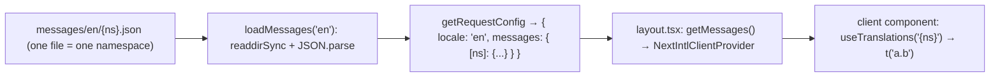
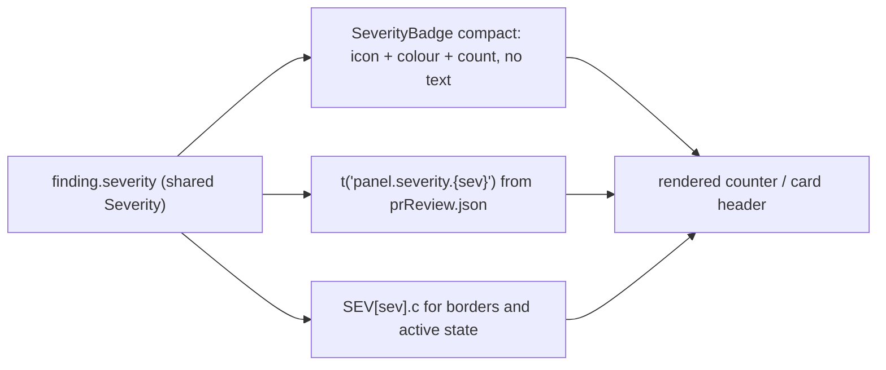

# i18n and severity rendering

Two mechanics every UI change touches: how next-intl strings reach a component (in the app and in
tests), and how a finding's severity becomes a colour, an icon and a label. The **rules**
(strings go in `messages/`, import only from the `@devdigest/ui` barrel, CSS variables only) are in
[`../CLAUDE.md`](../CLAUDE.md) under Conventions; the design-system layers and token list are in
[`../src/vendor/ui/README.md`](../src/vendor/ui/README.md). This file explains how they work.

## How messages are loaded

- `loadMessages` reads **every** `*.json` in `messages/<locale>/` and keys it by file name. A new
  `messages/en/<feature>.json` needs no registration anywhere:
  `client/src/i18n/request.ts:16` (`loadMessages`).
- One locale, `en`, and no locale routing: `client/src/i18n/request.ts:14` (`LOCALE`).
- The plugin points at that file: `client/next.config.mjs:3` (`createNextIntlPlugin`). The root
  layout passes all messages to the client provider:
  `client/src/app/layout.tsx:16` (`getMessages`).
- A namespace can be nested: `useTranslations("prReview.list.findings")` scopes `t` to that subtree:
  `client/src/app/repos/[repoId]/pulls/_components/FindingsCell/FindingsCell.tsx:17` (`useTranslations`).

Namespaces with a `useTranslations` caller today: `agents`, `common`, `prReview`, `runs`, `settings`,
`shell`. The other files in `messages/en/` (`blast`, `brief`, `ci`, `eval`, `memory`, …) are
vendored ahead of their milestones.

### In tests

Tests do **not** go through `loadMessages`. Each test wraps the component in its own provider and
imports only the namespace it needs:
`client/src/app/repos/[repoId]/pulls/[number]/_components/SeverityCounters/SeverityCounters.test.tsx:11` (`NextIntlClientProvider`).
If a component starts using a second namespace, its test wrapper must add it, or `t()` returns
the raw key and text assertions fail.

Not every string is translated yet: `FindingsTab` still has inline English ("Live review",
"Cancel", "Review runs"): `client/src/app/repos/[repoId]/pulls/[number]/_components/FindingsTab/FindingsTab.tsx:97` (`Live review`).

## Severity: two types, one map

| | Values | Defined in | Use for |
|---|---|---|---|
| `Severity` from `@devdigest/shared` | `CRITICAL`, `WARNING`, `SUGGESTION` | the Zod contract (finding data) | data, props, filters |
| `Severity` from `@devdigest/ui` | the same plus `INFO` | `client/src/vendor/ui/primitives/tokens.ts:3` (`Severity`) | only as the key type of `SEV` |

`SEV[severity]` gives `{ c, bg, icon, label }`, where `c` and `bg` are CSS variables (`--crit`,
`--warn`, `--sugg`, `--info` and their `-bg` pairs): `client/src/vendor/ui/primitives/tokens.ts:6` (`SEV`).
The variables switch with the theme, so no component needs a dark/light branch.

### From finding to pixels

- `SeverityBadge` renders the icon, the optional count and, **unless `compact`**, the English
  `SEV.label`: `client/src/vendor/ui/primitives/Badge.tsx:52` (`SeverityBadge`),
  `client/src/vendor/ui/primitives/Badge.tsx:80` (`compact ? null : s.label`).
- So app code uses `compact` and puts the translated label next to it. `SeverityCounters` is the
  reference: badge, then ``t(`panel.severity.${sev}`)``, with `SEV[sev].c` for the active border:
  `client/src/app/repos/[repoId]/pulls/[number]/_components/SeverityCounters/SeverityCounters.tsx:49` (`SeverityBadge`).
- The same pattern in the PR list: `client/src/app/repos/[repoId]/pulls/_components/FindingsCell/FindingsCell.tsx:61` (`SeverityBadge`).
- `FindingCard` shows only the compact badge, no label:
  `client/src/app/repos/[repoId]/pulls/[number]/_components/FindingCard/FindingCard.tsx:58` (`SeverityBadge`).

`CategoryTag` has the same issue with no `compact` escape: it always prints the English `CAT` label.

### Where the severity order lives

- `SEVERITY_LEVELS` (the three levels in display order, with a compile-time check that every shared
  `Severity` is listed): `client/src/app/repos/[repoId]/pulls/[number]/_components/FindingsPanel/helpers.ts:16` (`SEVERITY_LEVELS`).
- `SEVERITY_ORDER` (sort weights, includes `INFO: 3` for legacy rows):
  `client/src/app/repos/[repoId]/pulls/[number]/_components/FindingsPanel/constants.ts:4` (`SEVERITY_ORDER`).

They are plain literals because a value import from `@devdigest/shared` breaks the Next build
(see `client/insights.md`, "Module not found").

## Anatomy of a `_components/<Name>/` folder

`FindingsPanel/` has the full set; others carry only what they need.

| File | Holds | Required |
|---|---|---|
| `<Name>.tsx` | the component, `"use client"` | yes |
| `index.ts` | `export { Name, Name as default }` | yes |
| `<Name>.test.tsx` | RTL test with its own intl wrapper | expected for new components |
| `styles.ts` | `export const s = { key: {...} satisfies CSSProperties }` | when styles are non-trivial |
| `constants.ts` | thresholds, key maps, sort weights | when there are any |
| `helpers.ts` (+ `helpers.test.ts`) | pure functions | when there is logic worth unit-testing |
| `_components/` | private children | when the component has its own subtree |

Real examples: `FindingsPanel/` has all of the above except `_components/`; `RunTraceDrawer/` adds
`_components/`; `FindingsTab/` and `ReviewRunAccordion/` have no test, and `ReviewRunAccordion/` has
no `styles.ts` (inline styles in the component).

## Pitfalls

- Do not mix `border` shorthand and `borderColor` in one inline style object: React drops the
  longhand on re-render (details in `client/insights.md`).
- `messages/en/prReview.json` holds labels for the three shared levels only. Rendering `INFO` with a
  label would need a new key.
