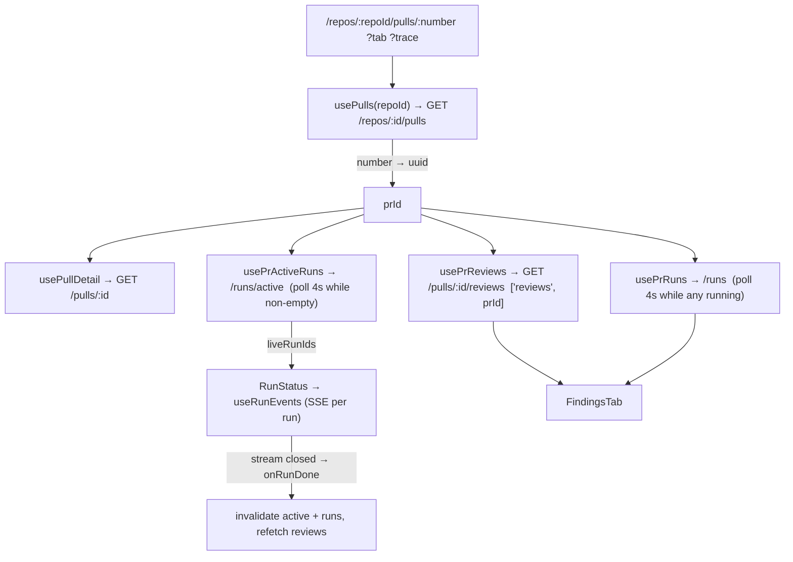

# PR page data flow

How `/repos/:repoId/pulls/:number` loads its data, tracks live runs, and renders the Agent runs
tab down to each finding card. The route map is in [`../README.md`](../README.md). The server
side of runs and events: [`../../server/docs/run-events-and-trace.md`](../../server/docs/run-events-and-trace.md).

Paths below are shortened: `PR/` = `client/src/app/repos/[repoId]/pulls/[number]/`.

## Queries the page owns



- **The route is keyed by PR number, the API by uuid.** The page finds the uuid in the cached PR
  list before any PR request: `client/src/app/repos/[repoId]/pulls/[number]/page.tsx:35` (`usePulls`).
  Until the list loads, every PR hook is disabled (`enabled: !!prId`).
- **Live runs come from the server, not from local state.** `usePrActiveRuns` asks for rows with
  `status='running'` and polls every 4 s only while the list is non-empty, so live tracking
  survives reloads and navigation: `client/src/lib/hooks/reviews.ts:28` (`usePrActiveRuns`).
- `usePrRuns` is the full run history (done, failed, cancelled), polling only while one is
  running: `client/src/lib/hooks/reviews.ts:40` (`usePrRuns`).
- `usePrReviews` is the persisted reviews with their findings, newest first. It does **not** poll:
  `client/src/lib/hooks/reviews.ts:51` (`usePrReviews`).
- Tab and trace drawer state live in the URL: `?tab=overview|findings|diff` and `?trace=<runId>`,
  written with `router.replace`: `client/src/app/repos/[repoId]/pulls/[number]/page.tsx:60` (`tab`).

## Live progress: SSE only where a log is shown

`useRunEvents(runIds)` opens one `EventSource` per run, accumulates `RunEvent`s, and sets
`running = false` when every stream has closed: `client/src/lib/hooks/reviews.ts:168` (`useRunEvents`).

- It listens to both the default message and the named `info | tool | result | error` events.
- An `error` event raises a toast, since agent failures never surface as a query error:
  `client/src/lib/hooks/reviews.ts:189` (`notify.error`).
- Only two components use it: `RunStatus` (Live review box) and `RunTraceDrawer`.
  `client/src/app/repos/[repoId]/pulls/[number]/_components/RunStatus/RunStatus.tsx:20` (`useRunEvents`).

When the streams close, `RunStatus` calls `onDone` once
(`client/src/app/repos/[repoId]/pulls/[number]/_components/RunStatus/RunStatus.tsx:23`, `wasRunning`).
The page then invalidates active runs and run history and refetches reviews:
`client/src/app/repos/[repoId]/pulls/[number]/page.tsx:156` (`onRunDone`). That refetch is what
makes a new review accordion appear.

## Starting a run

`useRunReview` posts `{ agentId }` or `{ all: true }`. On success it invalidates `reviews`
immediately, before any run has finished, so this refetch usually returns nothing new:
`client/src/lib/hooks/reviews.ts:124` (`useRunReview`). The header's `onRunsStarted` invalidates
the active-runs query, which is what brings in the new `liveRunIds`:
`client/src/app/repos/[repoId]/pulls/[number]/page.tsx:133` (`onRunsStarted`).

## Component chain on the Agent runs tab

```text
page.tsx
└─ FindingsTab            live box (RunStatus) · Timeline (RunHistory) · Review runs list
   └─ ReviewRunAccordion  one per review, newest first; first one open
      ├─ VerdictBanner    verdict, summary, score, cost from the matching run
      └─ FindingsPanel    SeverityCounters + hide-low toggle + FindingCard list
```

- `FindingsTab` renders one accordion per **review**, not per run. It finds the run behind each
  review by `review.run_id` to get cost and tokens: `client/src/app/repos/[repoId]/pulls/[number]/_components/FindingsTab/FindingsTab.tsx:167` (`run`).
  A review with no `run_id` (the seed) has no cost line.
- Clicking an agent in the Timeline sets `{ runId, n }`, and the matching accordion opens and
  scrolls into view. The nonce makes a second click on the same run work:
  `client/src/app/repos/[repoId]/pulls/[number]/_components/FindingsTab/FindingsTab.tsx:69` (`target`).
- The accordion header's blocker count is computed **in the client** as CRITICAL and not dismissed:
  `client/src/app/repos/[repoId]/pulls/[number]/_components/ReviewRunAccordion/ReviewRunAccordion.tsx:59` (`blockers`).
  It can differ from `agent_runs.blockers`, which uses the agent's `ci_fail_on`.

## Filters inside one run

`FindingsPanel` holds `hideLow`, `severity` and `focusIdx` per run:
`client/src/app/repos/[repoId]/pulls/[number]/_components/FindingsPanel/FindingsPanel.tsx:29` (`hideLow`).

1. `visibleFindings` drops confidence below `LOW_CONFIDENCE_THRESHOLD = 0.65` when `hideLow` is
   on, then sorts by severity: `client/src/app/repos/[repoId]/pulls/[number]/_components/FindingsPanel/helpers.ts:7` (`visibleFindings`).
2. `countBySeverity` counts that list, so a counter equals the cards shown when it is clicked.
   Unknown levels such as a legacy `INFO` are ignored:
   `client/src/app/repos/[repoId]/pulls/[number]/_components/FindingsPanel/helpers.ts:24` (`countBySeverity`).
3. `filterBySeverity` applies the active level; clicking the active counter clears it:
   `client/src/app/repos/[repoId]/pulls/[number]/_components/FindingsPanel/FindingsPanel.tsx:39` (`toggleSeverity`).
4. The list container is keyed by `` `${severity ?? "all"}:${hideLow}` ``, so cards remount and the first card
   opens again after any filter change: `client/src/app/repos/[repoId]/pulls/[number]/_components/FindingsPanel/FindingsPanel.tsx:80` (`key`).

Keyboard: `j`/`k` move focus, `a`/`d` accept or dismiss the focused card, ignored inside inputs:
`client/src/app/repos/[repoId]/pulls/[number]/_components/FindingsPanel/FindingsPanel.tsx:55` (`handler`).

## Mutations and what they refresh

| Hook | Request | Invalidates |
|---|---|---|
| `useFindingAction` | `POST /findings/:id/accept` or `/dismiss` | `['reviews', prId]` |
| `useDeleteReview` | `DELETE /reviews/:id` | `['reviews', prId]` |
| `useDeleteRun` | `DELETE /runs/:id` | `['pr-runs', prId]`, `['reviews', prId]` |
| `useCancelRun` | `POST /runs/:id/cancel` | nothing; the closing stream triggers `onRunDone` |

Source: `client/src/lib/hooks/reviews.ts:139` (`useFindingAction`),
`client/src/lib/hooks/reviews.ts:60` (`useDeleteRun`).

## Pitfalls

- None of these mutations invalidates the PR list query, so the list's SCORE, COST and FINDINGS
  update only on its 60 s refetch.
- Do not add a severity level in one place only: `SEVERITY_LEVELS` has a compile-time
  exhaustiveness check against `Severity`:
  `client/src/app/repos/[repoId]/pulls/[number]/_components/FindingsPanel/helpers.ts:16` (`SEVERITY_LEVELS`).
