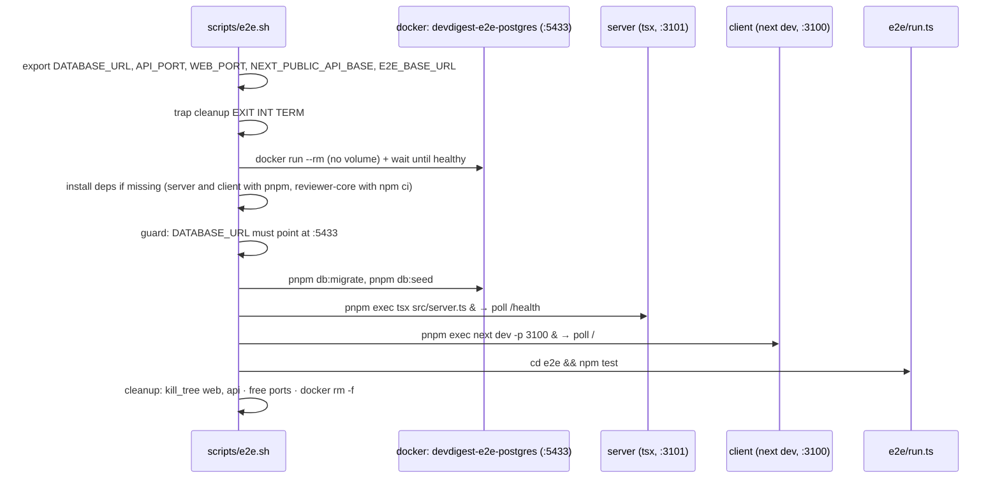

# How e2e works

What `scripts/e2e.sh` does under the hood, what makes the flows deterministic, and how to add a
flow without breaking that. The flow format, run commands, env knobs and coverage table are in
[`../README.md`](../README.md); this file does not repeat them.

## The hermetic stack, step by step

Key mechanics, with the line that does it:

- **Env is exported before anything starts.** dotenv never overrides variables that are already
  set, so the exported values beat `server/.env` without editing it. `WEB_PORT` matters too: the
  API derives its CORS origin from it. `127.0.0.1` avoids an IPv6 `::1` vs IPv4 mismatch with the
  container: `scripts/e2e.sh:40` (`export DATABASE_URL`).
- **The trap is installed before the first process starts**, so Ctrl-C or a failure still tears
  everything down: `scripts/e2e.sh:82` (`trap cleanup EXIT INT TERM`).
- **`kill_tree` walks the process tree leaves-first.** `pnpm exec tsx` and `next dev` run the real
  listener as a grandchild, so killing only the PID would leave the port bound:
  `scripts/e2e.sh:60` (`kill_tree`). As a backstop, `cleanup` also kills whatever still listens
  on the two isolated ports, never 3000/3001: `scripts/e2e.sh:74` (`for port in`).
- **Postgres is ephemeral**: `--rm`, no named volume, bound to `127.0.0.1` only, with a
  `pg_isready` health check polled for up to 60 s: `scripts/e2e.sh:87` (`docker run`).
- **reviewer-core needs its own `node_modules`** even though nothing compiles it: the API imports
  its source through the tsconfig alias and crashes with `ERR_MODULE_NOT_FOUND` without them:
  `scripts/e2e.sh:117` (`npm ci`).
- **A hard guard refuses to migrate or seed** unless `DATABASE_URL` contains `:5433/`:
  `scripts/e2e.sh:121` (`case "$DATABASE_URL"`).
- **The API runs with plain `tsx`**, not `tsx watch` (a mid-suite restart would break flows) and
  not `pnpm start` (needs a build). Each health wait gives up early if the process has died
  (`kill -0`): `scripts/e2e.sh:134` (`pnpm exec tsx src/server.ts`), `scripts/e2e.sh:140` (`kill -0`).
- **The exit code** of `npm test` is captured with `set +e` and passed through the trap:
  `scripts/e2e.sh:162` (`set +e`).

### How CI differs

`.github/workflows/e2e-web.yml` does not call this script. It has no Postgres service: it starts
the repo's compose Postgres with `docker compose up -d` and polls its health
(`.github/workflows/e2e-web.yml:56`), then runs migrate and seed, starts the API with `tsx`, and serves the client with **`pnpm build` + `pnpm start`**
(a production build), while the local script uses `next dev`: `.github/workflows/e2e-web.yml:101`
(`pnpm build`). A flow that passes locally can still fail in CI on a build-only error, and the
reverse.

## The runner in one paragraph

`run.ts` loads `specs/*.flow.json` in lexical order (`e2e/run.ts:53`, `loadFlows`), runs each step
as one `agent-browser` process with a 60 s timeout against a shared browser session, stops the flow
at the first failure and writes `test-results/<id>-fail.png` (`e2e/run.ts:63`, `runFlow`), then
always runs `agent-browser close` and exits 1 if any flow failed (`e2e/run.ts:95`, `main`).
Flows share the session, so a flow must start with its own `open`.

## The determinism contract

Every assertion is a fixed string from `server/src/db/seed.ts`. Editing the seed means editing
the flows.

| Flow | Asserts | Comes from |
|---|---|---|
| 01, 02, 04, 05 | `/` redirects to `/repos/<id>/pulls` of the **first** repo | the seed's only repo `acme/payments-api`: `server/src/db/seed.ts:85` (`fullName`) |
| 02, 04, 05 | row "Add rate limiting to public API endpoints", URL `/pulls/482` | `server/src/db/seed.ts:105` (`number: 482`) |
| 03 | "Security Reviewer" | `server/src/db/seed.ts:194` (`name`) |
| 04 | "request changes" | `server/src/db/seed.ts:142` (`verdict`) |
| 04 | "2 findings" | the two finding rows: `server/src/db/seed.ts:158` and `server/src/db/seed.ts:170` (`title`) |
| 04 | "Hardcoded Stripe secret key in commit" visible without a click | `server/src/db/seed.ts:158` (`title`) plus the first accordion being open by default |
| 05 | "src/config.ts" in Files changed | `server/src/db/seed.ts:123` (`path`) |
| 06, 07 | page headings | client `messages/en/*.json` and components, not the seed |

Two non-obvious facts behind flow 04:

- The Agent runs accordion is built from **reviews**, not runs. The seed review has no
  `agent_runs` row and no `run_id`, and the flow still passes. Adding a seeded run would not change
  what it checks. See [`../../client/docs/pr-page-data-flow.md`](../../client/docs/pr-page-data-flow.md).
- "2 findings" counts **all** findings of that review, including any you accept or dismiss.

PR detail and Files changed work offline because `GET /pulls/:id` falls back to the stored
`pr_files` when GitHub fails: [`../../server/docs/repo-and-pr-ingestion.md`](../../server/docs/repo-and-pr-ingestion.md).

## Adding a flow: checklist

1. Name it `specs/NN-<what>.flow.json` with the next number. Lexical order is run order.
2. Start with `open {BASE}/…`. Never rely on the page a previous flow left behind.
3. Assert only with `wait --url`, `wait --text`, `find role|text|label`. Never `chat`.
4. Use only strings that already exist in the seed or in `messages/en/*.json`. If you need new
   data, add it to `server/src/db/seed.ts` (idempotent) and add a row to the table above.
5. Do not click anything that starts a review, posts a comment or saves a key: those call an LLM
   or GitHub.
6. After `open` on a data page, add `wait --load networkidle` before asserting on fetched text.
7. Run `./scripts/e2e.sh` locally, then update the coverage table in `../README.md`.

## Pitfalls

- The hermetic stack isolates the **database and ports, not secrets**. The API still reads
  `~/.devdigest/secrets.json`. With a real `GITHUB_TOKEN` there, PR list and detail calls try GitHub
  for `acme/payments-api`, fail, and fall back to the seed. Flows still pass, but more slowly.
- `docker compose down -v` is never the way to get a clean DB for e2e; this script is.
