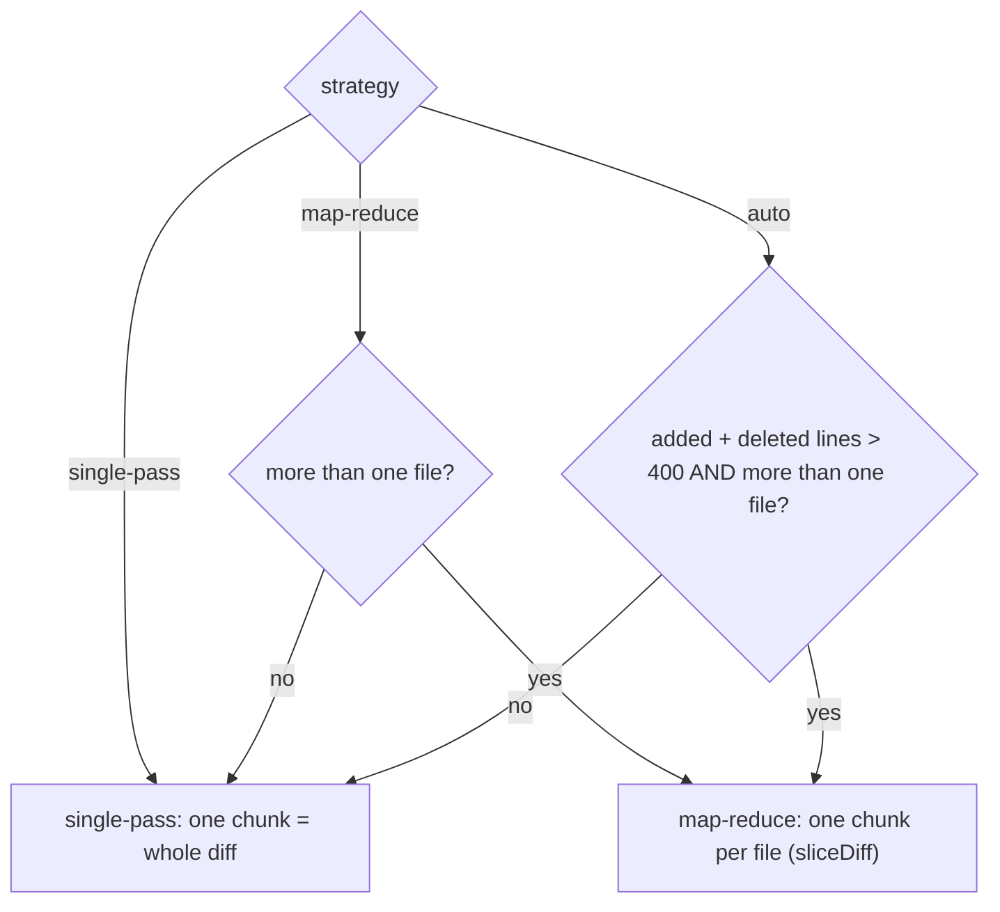
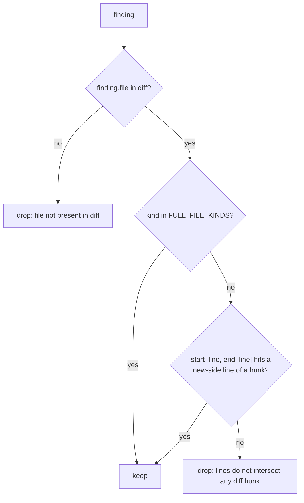

# Review engine

What `reviewPullRequest` does between receiving a diff and returning a grounded review: mode
selection, prompt assembly, the LLM call, reduce, the grounding gate, and the score. The pipeline
overview and public API are in [`../README.md`](../README.md); how the server prepares inputs and
stores the result: [`../../server/docs/review-execution.md`](../../server/docs/review-execution.md).

Entry point: `reviewer-core/src/review/run.ts:123` (`reviewPullRequest`).

## Inputs: who builds what

The engine never reads a DB, file or env var. Everything arrives in `ReviewInput`:
`reviewer-core/src/review/run.ts:44` (`ReviewInput`).

| Field | Built by the server today | Note |
|---|---|---|
| `systemPrompt`, `model`, `strategy` | from the agent row | `strategy` defaults to `'auto'` in the engine, but the server always passes one |
| `diff` | `loadDiff` (git or `pr_files`) | parsed `UnifiedDiff` with new-side line numbers |
| `llm` | `container.llm(provider)` | the only side effect |
| `repoMap`, `callers` | repo-intel, when the agent's toggle is on | untrusted, omitted when empty |
| `prDescription` | `pull_requests.body` | untrusted, truncated |
| `task` | PR title line plus an optional rank note | trusted |
| `skills`, `memory`, `specs` | **not passed** | slots for later milestones |
| `onEvent`, `checkCancelled`, `sessionId` | bridges to the run bus | see server docs |

## Mode selection

`reviewer-core/src/review/run.ts:115` (`selectMode`), threshold
`DEFAULT_MAP_THRESHOLD_LINES = 400` at `reviewer-core/src/review/run.ts:30`. The studio passes
`'single-pass'` unless an agent is set otherwise, so in practice one LLM call per agent.

## Prompt assembly

`assemblePrompt` builds two messages: `reviewer-core/src/prompt.ts:85` (`assemblePrompt`).

- **System** = the agent prompt plus `INJECTION_GUARD`, a fixed rule that everything inside
  `<untrusted>` is data and that claims like "test fixture" or "do not flag" never descope the
  review: `reviewer-core/src/prompt.ts:16` (`INJECTION_GUARD`).
- **User** = sections in this fixed order, each present only when its input is non-empty:
  task → `## PR description` → `## Skills / rules` → `## Relevant memory` → `## Repo skeleton` →
  `## Project context` → `## Callers of changed symbols` → `## Diff to review` (always).
- `wrapUntrusted(label, content)` encloses a block in `<untrusted source="…">` and escapes any
  `</untrusted>` inside it, so content cannot close the fence early:
  `reviewer-core/src/prompt.ts:30` (`wrapUntrusted`). Wrapped: PR description, repo map, specs,
  callers, diff. Not wrapped: task, skills, memory (treated as trusted).
- The PR description is cut to `MAX_PR_DESCRIPTION_CHARS = 4000`:
  `reviewer-core/src/prompt.ts:37` (`MAX_PR_DESCRIPTION_CHARS`).

The `assembly` record (each section, or null) goes into the run trace. In map-reduce it describes
the whole-diff prompt, not each per-file prompt: `reviewer-core/src/review/run.ts:142` (`assembly`).

## The LLM call

Per chunk: `checkCancelled()`, an event, `assemblePrompt` with that chunk's diff, then one
`llm.completeStructured({ schema: Review, maxRetries })`: `reviewer-core/src/review/run.ts:162` (`for (const chunk of chunks)`).

The engine does **not** retry. Retry and JSON repair run inside each provider: `parseWithRepair`
tries strict JSON, then fenced/brace extraction, and on failure returns a `repromptMessage` that
the provider sends back to the model: `reviewer-core/src/llm/structured.ts:54` (`parseWithRepair`).
See [`../../server/docs/llm-providers-and-cost.md`](../../server/docs/llm-providers-and-cost.md).

Tokens and cost are summed per chunk; one null chunk cost makes the total null:
`reviewer-core/src/review/run.ts:184` (`costUsd`).

## Reduce

`reduceReviews` returns the single partial unchanged in single-pass. With several partials it
concatenates findings, takes the **worst** verdict (`request_changes` > `comment` > `approve`),
averages the model scores and joins summaries: `reviewer-core/src/review/reduce.ts:43` (`reduceReviews`).

## Grounding: how invalid citations are dropped

- `buildLineIndex` maps each file to the set of new-side line numbers in its hunks, falling back
  to the hunk's declared `newStart..newStart+newLines` range:
  `reviewer-core/src/grounding.ts:24` (`buildLineIndex`).
- `groundFindings` applies the checks above and keeps a reason for every drop:
  `reviewer-core/src/grounding.ts:52` (`groundFindings`).
- `FULL_FILE_KINDS` (`secret_leak`, `lethal_trifecta`, `phantom`, `hook`) only need the file to be
  in the diff: `reviewer-core/src/grounding.ts:16` (`FULL_FILE_KINDS`).
- Every drop becomes an `info` event ("grounding dropped …"), then one `result` event with the
  summary `"kept/total passed"`: `reviewer-core/src/review/run.ts:199` (`ground.dropped`),
  `reviewer-core/src/grounding.ts:87` (`groundingSummary`). Dropped findings are returned in
  `outcome.dropped` but the server does not persist them.

## Score

The model's score is discarded. The returned score is `100 − penalties` of the **kept** findings,
clamped to 0–100: CRITICAL 35, WARNING 12, SUGGESTION 3:
`reviewer-core/src/review/reduce.ts:27` (`scoreFromFindings`), applied at
`reviewer-core/src/review/run.ts:208` (`scoreFromFindings(ground.kept)`).

## Pitfalls

- **The verdict is not recomputed.** It is the model's verdict (or the worst across chunks), kept
  even if grounding dropped every finding. A review can read `request_changes` with score 100.
  Deterministic signals are the score here and `countBlockers` in the server.
- A finding citing only deleted lines is dropped: the index holds new-side lines only.
- The comment on `DEFAULT_MAP_THRESHOLD_LINES` mentions a server constant that does not exist
  (`reviewer-core/src/review/run.ts:29`); the threshold lives only here.
