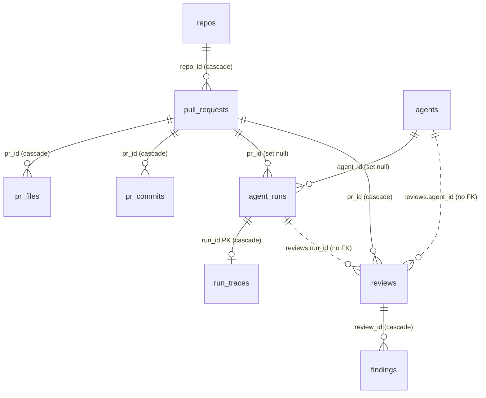

# Data model

The tables the starter reads and writes today, how they link, what the nullable columns mean,
and which tables sit empty until a roadmap milestone fills them. Schema files are
`server/src/db/schema/<domain>.ts`, re-exported by `server/src/db/schema.ts`. The rules for
the PR list's score, cost and findings live only in [pr-list-aggregates.md](pr-list-aggregates.md).

## The review path

Solid lines are real foreign keys; dotted lines are plain uuid columns without a constraint.

| Table | Key facts | Code |
|---|---|---|
| `repos` | unique `(workspace_id, full_name)`; `clone_path` set by the clone job | `server/src/db/schema/repos.ts:5` (`repos`) |
| `pull_requests` | unique `(repo_id, number)`; `status` = GitHub merge state; `last_reviewed_sha` set after each successful review | `server/src/db/schema/pulls.ts:5` (`pullRequests`) |
| `pr_files` / `pr_commits` | replaced wholesale on each PR detail refresh; `patch` is the review's fallback diff | `server/src/db/schema/pulls.ts:36` (`prFiles`) |
| `agents` | `provider` enum, `strategy` default `single-pass`, `ci_fail_on`, `repo_intel` toggle | `server/src/db/schema/agents.ts:8` (`agents`) |
| `agent_runs` | one row per agent per review request; `status` is `running`/`done`/`failed`/`cancelled` (free text, not an enum) | `server/src/db/schema/runs.ts:8` (`agentRuns`) |
| `run_traces` | one jsonb `RunTrace` per run | `server/src/db/schema/runs.ts:35` (`runTraces`) |
| `reviews` | `kind` `review`/`summary`; `run_id` links back to the run | `server/src/db/schema/reviews.ts:9` (`reviews`) |
| `findings` | grounded findings only; `accepted_at` / `dismissed_at` for actions | `server/src/db/schema/reviews.ts:28` (`findings`) |
| `jobs` | JobRunner mirror for clone/index jobs, not reviews | `server/src/db/schema/ops.ts:6` (`jobs`) |

## Links that surprise people

- **Run → findings goes through `reviews.run_id`.** There is no FK and no `findings.run_id`:
  `server/src/db/schema/reviews.ts:19` (`reviews.runId`). Join `findings → reviews → agent_runs`
  on `reviews.run_id = agent_runs.id`, never by `agent_id` plus time.
- **`reviews.agent_id` has no FK either** (`server/src/db/schema/reviews.ts:17`). Deleting an agent
  sets `agent_runs.agent_id` to null but leaves reviews pointing at a missing agent.
- **Deleting a PR does not delete its runs.** `agent_runs.pr_id` is `set null`
  (`server/src/db/schema/runs.ts:14`), while reviews and findings cascade away.
- **The seed review has no run.** `pnpm db:seed` inserts a `review` with score 61 and two findings
  but no `agent_runs` row and no `run_id`: `server/src/db/seed.ts:136` (`insert(t.reviews)`).

## Nullable columns on `agent_runs`

| Column | `done` | `failed` / `cancelled` | Notes |
|---|---|---|---|
| `tokens_in`, `tokens_out` | real totals over all attempts | `0`, not null | "both 0" means no usage |
| `cost_usd` | number, or null if the model is unpriced | `null` | see [llm-providers-and-cost.md](llm-providers-and-cost.md) |
| `score` | engine's recomputed 0–100 | `null` | `server/src/db/schema/runs.ts:29` (`score`) |
| `blockers` | findings at or above `ci_fail_on` | `null` | `server/src/db/schema/runs.ts:31` (`blockers`) |
| `grounding` | `"k/n passed"` | `"0/0 passed"` | text, not a number |
| `error` | null | message (`Cancelled by user` for cancel) | `server/src/db/schema/runs.ts:24` (`error`) |

Writes happen only in `completeAgentRun`, which overwrites all of these at once:
`server/src/modules/reviews/repository/run.repo.ts:142` (`completeAgentRun`).

## Filled by other modules today

Not part of the review path, but not empty: `users`, `workspaces`, `workspace_members`, `settings`
(seed and Settings), `agent_versions` (agent edits), and the indexer's `symbols`, `references`,
`repo_index_state`, `file_edges`, `file_facts`, `file_rank`, `repo_map_cache`
(`server/src/modules/repo-intel/repository.ts`).

## Empty tables and their roadmap row

These tables exist so milestones only add modules. No module writes them today. "Roadmap row"
refers to the milestone table in [`../../README.md`](../../README.md) (lines 82–89); scope details
belong in `specs/`, not here.

| Table | Roadmap row | Schema |
|---|---|---|
| `skills`, `skill_versions`, `agent_skills` | M2 Skills in the product | `server/src/db/schema/skills.ts:5` (`skills`) |
| `conventions` | M2 Conventions extractor | `server/src/db/schema/knowledge.ts:31` (`conventions`) |
| `pr_intent` | M3 Intent layer | `server/src/db/schema/reviews.ts:48` (`prIntent`) |
| `onboarding` | M5 Onboarding generator | `server/src/db/schema/context.ts:120` (`onboarding`) |
| `pr_brief` | M5 PR Brief card | `server/src/db/schema/reviews.ts:57` (`prBrief`) |
| `eval_cases`, `eval_runs` | M6 Eval pipeline | `server/src/db/schema/eval.ts:7` (`evalCases`) |
| `ci_installations`, `ci_runs` | M6 Export to CI | `server/src/db/schema/ci.ts:14` (`ciRuns`) |
| `multi_agent_runs` | M7 Multi-agent review | `server/src/db/schema/runs.ts:42` (`multiAgentRuns`) |
| `memory` | M7 Persistent memory | `server/src/db/schema/knowledge.ts:8` (`memory`) |
| `installed_plugins` | M8 Plugin export/import | `server/src/db/schema/ops.ts:29` (`installedPlugins`) |
| `digests` | M8 weekly digest | `server/src/db/schema/ops.ts:41` (`digests`) |
| `code_chunks` | no roadmap row (embeddings, off by default) | `server/src/db/schema/context.ts:31` (`codeChunks`) |
| `conformance_checks` | no roadmap row | `server/src/db/schema/eval.ts:37` (`conformanceChecks`) |
| `composed_reviews` | no roadmap row | `server/src/db/schema/eval.ts:47` (`composedReviews`) |

Two have code that is ready but not called: `upsertIntent` / `getIntent` for `pr_intent`
(`server/src/modules/reviews/repository/pull.repo.ts:49`, `upsertIntent`) and the agent skills
route (`server/src/modules/agents/repository.ts:194`, `agentSkills` join), which has no skills to link.

## Pitfalls

- Never edit an applied migration in `server/src/db/migrations/`; change the schema file and run
  `pnpm db:generate`.
- `pull_requests.status` defaults to `needs_review` in the schema but holds GitHub's
  `open`/`merged`/`closed`. The review status the UI shows is derived on read.
