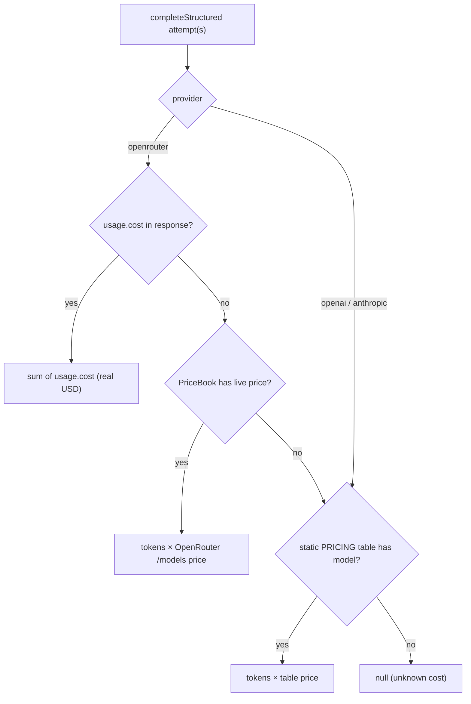

# LLM providers and cost

How the server picks an LLM provider for an agent, how structured output is retried, and
where `agent_runs.cost_usd` comes from. Where keys are stored: [`../README.md`](../README.md)
("Where keys live"). How cost is summed in the PR list: [pr-list-aggregates.md](pr-list-aggregates.md).

## Resolving a provider

`container.llm(id)` serves `'openai' | 'anthropic' | 'openrouter'`:
`server/src/platform/container.ts:165` (`Container.llm`).

1. A test override (`buildApp({ overrides: { llm } })`) wins.
2. Otherwise a cached instance per id. The cache is dropped by `invalidateSecretCaches()` after a
   key is saved.
3. Otherwise `buildLlm` reads the key from `SecretsProvider` and throws `ConfigError` when it is
   missing: `server/src/platform/container.ts:192` (`Container.buildLlm`).

| id | class | lives in |
|---|---|---|
| `openai` | `OpenAIProvider` | `server/src/adapters/llm/openai.ts` |
| `anthropic` | `AnthropicProvider` (tool-use for structured output) | `server/src/adapters/llm/anthropic.ts` |
| `openrouter` | `OpenRouterProvider` (OpenAI SDK against OpenRouter), built with an injected `estimateCost` | `reviewer-core/src/llm/openrouter.ts` |

The review executor resolves by `agent.provider`; a missing key fails only that agent's run
(see [review-execution.md](review-execution.md)). `llmWithKey` builds an uncached provider from a
candidate key for Settings' "Test connection", so a typo never overwrites a working key:
`server/src/platform/container.ts:181` (`Container.llmWithKey`).

## Structured output: retry and repair live in the provider

The engine makes one `completeStructured` call per chunk and does not retry itself. Each provider
runs its own loop of `maxRetries + 1` attempts (default `maxRetries = 2`):

- send the request with the Zod schema converted to JSON Schema;
- `parseWithRepair(schema, raw)`; on success return data, tokens, cost, raw text and `attempts`;
- on failure append the model's answer plus a re-prompt with the validation error and try again;
- after the last attempt, throw. The run then fails with that message.

References: `reviewer-core/src/llm/openrouter.ts:59` (`OpenRouterProvider.completeStructured`),
`server/src/adapters/llm/anthropic.ts:89` (`AnthropicProvider.completeStructured`),
`server/src/adapters/llm/openai.ts:88` (`OpenAIProvider.completeStructured`).
Tokens are summed over **all** attempts, so a repaired answer costs more than one call.

## Where `cost_usd` comes from

- **OpenRouter** asks for `usage: { include: true }` and sums `usage.cost` across attempts. Only
  if no attempt reported a cost does it call the injected estimator:
  `reviewer-core/src/llm/openrouter.ts:97` (`apiCost`), `reviewer-core/src/llm/openrouter.ts:107` (`costUsd`).
- The injected estimator is `PriceBook.estimate`: live prices from OpenRouter `/models`, cached for
  6 h, refreshed lazily in the background. It is synchronous, so the first call after a cold start
  returns the fallback: `server/src/platform/price-book.ts:34` (`PriceBook.estimate`).
  The fallback is the static table: `server/src/platform/container.ts:142` (`Container.priceBook`).
- **OpenAI and Anthropic** use only the static table, per 1M tokens:
  `server/src/adapters/llm/anthropic.ts:135` (`estimateCost`),
  `server/src/adapters/llm/pricing.ts:37` (`estimateCost`). An unknown model gives `null`, never 0.

## From call cost to run cost

- The engine adds up chunk costs, and **one** null chunk makes the whole run cost null:
  `reviewer-core/src/review/run.ts:184` (`costUsd`). In single-pass there is one chunk.
- Success: the executor stores that value in `agent_runs.cost_usd`.
- Failure or cancel: `cost_usd = null` and tokens `0/0`, whatever was spent
  ([run-events-and-trace.md](run-events-and-trace.md#failure-and-cancel)).

So `cost_usd = null` has three meanings today: the model is not priced, the run failed or was
cancelled, or the run predates cost storage. The UI shows these as "—", never `$0.00`.

## Present but not wired

These exist in `server/src/platform/` but nothing in `src/` imports them:

- `routeModel` (cheap vs capable model per task kind) and `PromptCache` (TTL cache by prompt
  hash): `server/src/platform/model-router.ts:27` (`routeModel`),
  `server/src/platform/model-router.ts:44` (`PromptCache`). Agents use exactly `agent.model`.
- `buildRunTrace`: `server/src/platform/trace-builder.ts:37` (`buildRunTrace`). The executor builds
  its trace inline instead.

## Pitfalls

- The static table has approximate prices and few models. A new OpenAI or Anthropic model gives a
  null cost until it is added to `PRICING`.
- `server/src/platform/model-router.ts` contains a literal NUL character, so `grep` treats it as
  binary. Use `grep -a`.
