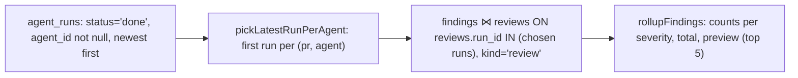
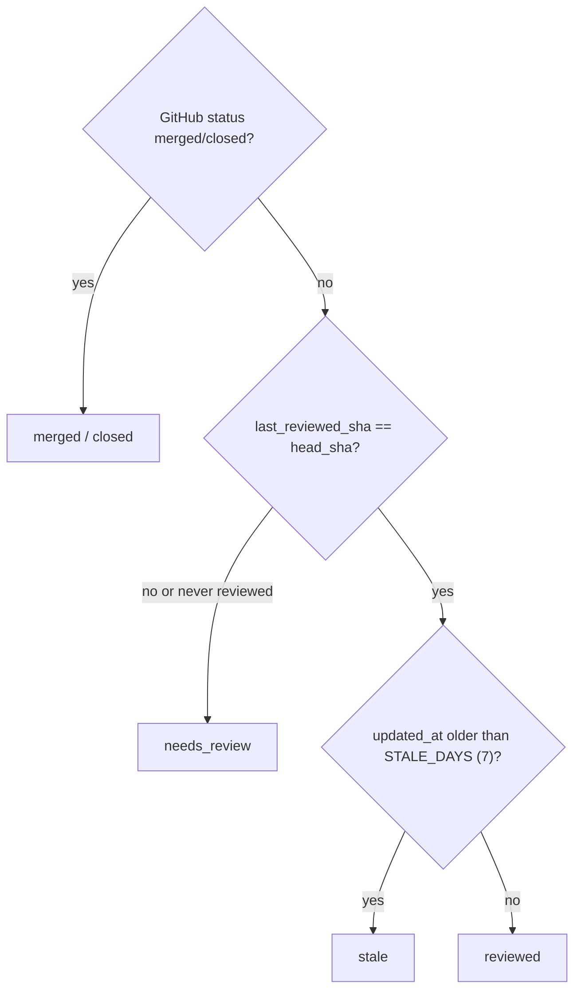

# PR list aggregates: score, cost, findings, status

`GET /repos/:id/pulls` returns each PR with four computed fields. This file is the **only** place
their rules are written down; other docs link here. How the list is synced from GitHub first:
[repo-and-pr-ingestion.md](repo-and-pr-ingestion.md). Product decisions behind them:
[`../specs/m1-run-cost-badge.md`](../specs/m1-run-cost-badge.md),
[`../specs/m1-findings-column.md`](../specs/m1-findings-column.md).

Everything is computed **on read**, with no denormalised columns: one `IN (prIds)` query per field
plus grouping in JS. The route: `server/src/modules/pulls/routes.ts:28` (`/repos/:id/pulls`).
Contracts: `server/src/vendor/shared/contracts/platform.ts:173` (`PrCost`),
`server/src/vendor/shared/contracts/platform.ts:196` (`PrFindings`).

## The four bases at a glance

| Field | Source rows | Picks | Null when |
|---|---|---|---|
| `score` | `reviews` with `kind='review'` | the single newest review of the PR, any agent | the PR has no review |
| `cost` | `agent_runs` with `status != 'running'` | **every** finished run, newest first | the PR has no finished run |
| `findings` | `agent_runs` with `status='done'` and an `agent_id`, then their findings via `reviews.run_id` | the latest done run **of each agent**, summed | no agent has a done run |
| `status` | `pull_requests` columns | derived, see below | never |

## score

Reviews are fetched newest-first; the first seen per PR wins:
`server/src/modules/pulls/routes.ts:121` (`latestReviewByPr`). It is the engine's recomputed
score stored on `reviews.score`, so it can come from a review that has **no run** (the seed).

## cost

`rollupRunCosts` receives finished runs newest-first, joined with the agent name:
`server/src/modules/pulls/routes.ts:136` (`costByPr`), `server/src/modules/pulls/cost.ts:22` (`rollupRunCosts`).

- `runs_count` counts every finished run: done, failed and cancelled.
- `total_usd` sums only runs with a known `cost_usd`. All unknown → `total_usd: null`, never 0.
- `runs[]` keeps every run (with `cost_usd: null` where unknown) so the tooltip can list them as "—".

Why a run's cost can be null: [llm-providers-and-cost.md](llm-providers-and-cost.md#from-call-cost-to-run-cost).

## findings

- `pickLatestRunPerAgent` keeps one run per `(pr, agent)`. A newer failed or cancelled run does not
  hide the agent's previous result, because only `done` runs are candidates. Runs of deleted agents
  (`agent_id` null) are skipped: `server/src/modules/pulls/findings.ts:39` (`pickLatestRunPerAgent`).
- `rollupFindings` gives every chosen PR an entry, with `total: 0` when nothing was found. Unknown
  severities are dropped. Accepted and dismissed findings still count:
  `server/src/modules/pulls/findings.ts:61` (`rollupFindings`).
- The preview is sorted CRITICAL → WARNING → SUGGESTION, then by confidence descending, cut to
  `PREVIEW_LIMIT = 5`, with rationale truncated to 160 chars:
  `server/src/modules/pulls/findings.ts:29` (`PREVIEW_LIMIT`).

## status

`deriveReviewStatus` maps GitHub state plus review freshness:
`server/src/modules/pulls/status.ts:40` (`deriveReviewStatus`).

`last_reviewed_sha` is written by every **successful** run (`markReviewed`), not by failed ones:
`server/src/modules/reviews/repository/pull.repo.ts:40` (`markReviewed`). `STALE_DAYS` is at
`server/src/modules/pulls/status.ts:14` (`STALE_DAYS`).

## Why score and findings disagree (on purpose)

Two situations make the columns look inconsistent; both are correct:

1. **Fresh seed.** PR #482 shows score 61 but `cost` and `findings` are null. The seed review has
   no run (`server/src/db/seed.ts:136`, `insert(t.reviews)`), and cost and findings are built from runs.
2. **Two agents.** The score ring shows whichever agent's review is newest; FINDINGS sums the latest
   done run of **both** agents.

Do not "unify" them without a spec change. To connect a run to its findings, use `reviews.run_id`.

## Tests

Pure helpers are unit-tested without a DB: `server/test/pulls-cost.test.ts`,
`server/test/pulls-findings.test.ts`, `server/test/pulls-status.test.ts`.

## Pitfalls

- Every new aggregate should follow the same pattern: one `IN` query, rows newest-first, a pure
  helper in `modules/pulls/<name>.ts` with its own unit test. Per-PR queries in the `rows.map`
  would make the list N+1.
- `status` uses the PR's `updated_at`, not the review time. A PR untouched for 8 days and reviewed
  today still reads `stale`.
