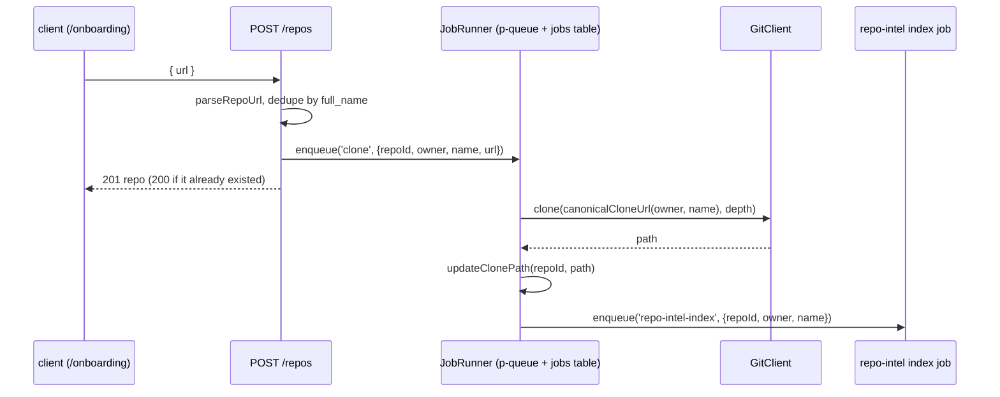

# Repo and PR ingestion

How a repository and its pull requests get into the database today: the clone job,
the PR list sync, the PR detail refresh, and inline comments. Route list and DI wiring
live in [`../README.md`](../README.md); the indexer itself is in
[`../src/modules/repo-intel/README.md`](../src/modules/repo-intel/README.md).

## Adding a repo: clone, then index

- `POST /repos` validates the body with `RepoInput` and returns 201 for a new repo or 200 for
  an existing one: `server/src/modules/repos/routes.ts:26` (`/repos`).
- `RepoService.add` parses the URL, dedupes inside the workspace by `full_name`, inserts the row
  and enqueues a `clone` job. It does not clone inline: `server/src/modules/repos/service.ts:87` (`RepoService.add`).
- The clone handler never uses `payload.url`. It rebuilds the URL from the validated
  `owner/name`, because job rows persist and an old row could carry a user-supplied URL:
  `server/src/modules/repos/service.ts:47` (`RepoService.runCloneJob`).
- After the clone, the handler **enqueues** (does not call) the index job, so the clone job closes
  right away. If no index handler is registered, `enqueue` throws and the error is swallowed:
  `server/src/modules/repos/service.ts:66` (`workspaceIdFor`).
- `POST /repos/:id/refresh` enqueues a fresh `clone` plus a `repo-intel-refresh` job. Ordering
  between the two is not guaranteed; the incremental indexer is a no-op when HEAD did not move:
  `server/src/modules/repos/service.ts:115` (`RepoService.refresh`).

### JobRunner in one paragraph

`JobRunner.enqueue` looks up the handler by kind (throws if missing), inserts a `jobs` row as
`queued`, and schedules it on a p-queue with concurrency 3. Each attempt is wrapped in a 120 s
timeout and retried twice; the row moves through `running` → `done` / `failed` with `attempts`
and `error`: `server/src/platform/jobs.ts:49` (`JobRunner.enqueue`), defaults at
`server/src/platform/jobs.ts:40` (`JobRunner constructor`). Handlers are registered when module
routes register: `server/src/modules/repos/routes.ts:24` (`registerCloneJobHandler`). Reviews do
**not** go through JobRunner (see [review-execution.md](review-execution.md)).

## PR list: synced on read

There is no separate "import PRs" step. `GET /repos/:id/pulls` does the sync itself:

1. Tries to get a GitHub client. No token or offline → log a warning and serve what is stored:
   `server/src/modules/pulls/routes.ts:36` (`GitHubClient`).
2. Upserts every PR from `listPullRequests` on the unique `(repo_id, number)` index. On conflict
   only `title`, `head_sha`, `status`, `updated_at` are updated:
   `server/src/modules/pulls/routes.ts:47` (`listPullRequests`), index at
   `server/src/db/schema/pulls.ts:31` (`pr_repo_number_uq`).
3. Backfills diff stats for up to `BACKFILL_LIMIT = 10` PRs per request whose
   `additions`, `deletions` and `files_count` are all 0, because the list payload from GitHub has
   no stats: `server/src/modules/pulls/routes.ts:91` (`BACKFILL_LIMIT`).
4. Computes the per-row score, cost, findings and status. That logic is documented in
   [pr-list-aggregates.md](pr-list-aggregates.md).

The client repeats this request every 60 s (`refetchInterval: 60_000`), which is what chips away
at the backfill remainder: `client/src/lib/hooks/core.ts:102` (`usePulls`).

`POST /repos/:id/poll` does a similar upsert and bumps `repos.last_polled_at`, but no client code
calls it today: `server/src/modules/polling/routes.ts:20` (`/repos/:id/poll`). It never triggers a
review: `server/src/modules/polling/routes.ts:65` (`reviewTriggered: false`).

## PR detail: refreshed when possible, persisted otherwise

`GET /pulls/:id` is local-first:

- With a GitHub client, it fetches the detail, **replaces** `pr_files` and `pr_commits`
  (delete, then insert) and updates `body` and the diff stats:
  `server/src/modules/pulls/routes.ts:245` (`getPullRequest`).
- Any failure (no token, offline, API error) falls back to the stored rows, so seeded or
  previously imported PRs stay readable: `server/src/modules/pulls/routes.ts:286` (`catch`).

`pr_files.patch` matters beyond the UI: it is the fallback diff source for a review when
`git diff` against the clone fails or is empty (`diffFromPrFiles`, see
[review-execution.md](review-execution.md)).

## Inline comments: proxied, never stored

- `GET /pulls/:id/comments` returns GitHub review comments live. No client or any error →
  `[]`: `server/src/modules/pulls/routes.ts:336` (`/pulls/:id/comments`).
- `POST /pulls/:id/comments` posts against `pr.headSha`. Without a token it returns
  `github_unavailable` (400); a GitHub rejection becomes `github_comment_failed` (400):
  `server/src/modules/pulls/routes.ts:358` (`/pulls/:id/comments`).

No table holds these comments; the Files changed tab always shows the GitHub state.

## Pitfalls

- A stale code comment points to `POST /repos/:id/reindex`
  (`server/src/modules/repos/service.ts:77`); the real route is `POST /repos/:id/resync`:
  `server/src/modules/repo-intel/routes.ts:43` (`resync`).
- The PR list upsert does **not** update `branch`, `base`, `additions`, `deletions` or `files_count` on
  conflict. Stats change only through the backfill (all three at 0) or a detail fetch.
