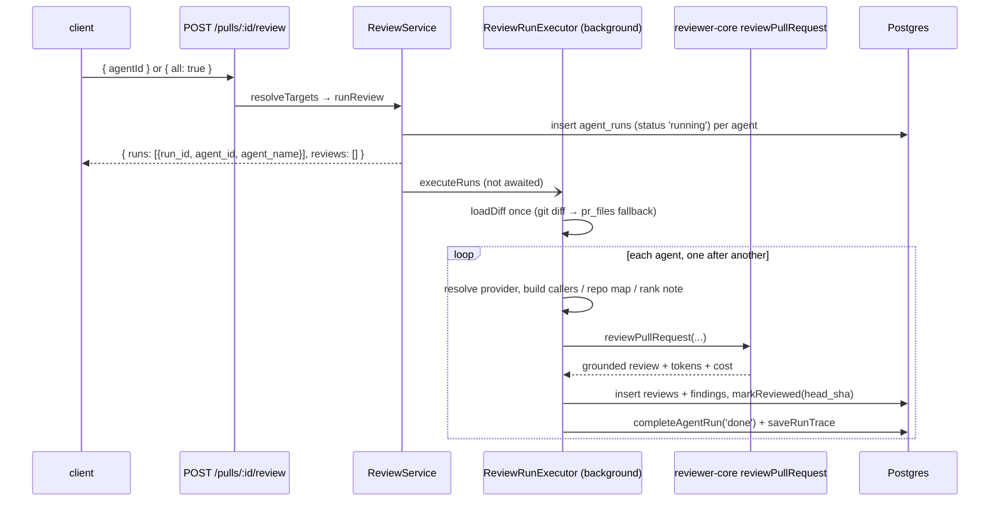

# Review execution

What happens from `POST /pulls/:id/review` until the review, findings, cost and score are
in the database. How PRs and diffs get in first: [repo-and-pr-ingestion.md](repo-and-pr-ingestion.md).
Live progress and the trace: [run-events-and-trace.md](run-events-and-trace.md). What the engine
does inside `reviewPullRequest`: [`../../reviewer-core/docs/review-engine.md`](../../reviewer-core/docs/review-engine.md).

## The sequence

## 1. Request and targets

- The route has its own rate limit of 10 per minute, since every call can fan out into LLM
  calls. The body is parsed by hand with `RunRequest.parse(req.body ?? {})`, so an empty body is
  allowed: `server/src/modules/reviews/routes.ts:27` (`/pulls/:id/review`).
- `resolveTargets`: `all: true` → every **enabled** agent; `agentId` → that agent (404 if
  missing); neither → `invalid_run_request` 400:
  `server/src/modules/reviews/service.ts:46` (`ReviewService.resolveTargets`).

## 2. Runs are created first, executed later

`runReview` creates one `agent_runs` row per agent **before** any work, so the client gets
`run_id`s at once and can subscribe to events. It then fires `executeRuns` with `void … .catch()`
and returns: `server/src/modules/reviews/service.ts:103` (`ReviewService.runReview`). The row
starts as `status: 'running'`: `server/src/modules/reviews/repository/run.repo.ts:117` (`createAgentRun`).

This is fire-and-forget, not JobRunner. Nothing persists the queue: a restart loses in-flight
runs, and the boot reaper marks them failed (see [run-events-and-trace.md](run-events-and-trace.md)).

## 3. Shared pre-work: the diff

`executeRuns` loads the diff **once** for all agents:
`server/src/modules/reviews/run-executor.ts:59` (`ReviewRunExecutor.executeRuns`).

- `loadDiff` tries `git diff base...head` on the clone. An error or an empty diff falls through to
  `diffFromPrFiles`, which glues the stored `pr_files.patch` rows into a synthetic unified diff:
  `server/src/modules/reviews/diff-loader.ts:12` (`loadDiff`),
  `server/src/modules/reviews/diff-loader.ts:33` (`diffFromPrFiles`).
- If the diff cannot load at all, `failAll` marks **every** queued run `failed` with the error
  text and saves a trace from the buffered log: `server/src/modules/reviews/run-executor.ts:78` (`failAll`).

## 4. Per agent, sequentially

Agents run in a `for … await` loop, one after another, not in parallel. A failure in one
agent is caught and logged; the next agent still runs:
`server/src/modules/reviews/run-executor.ts:112` (`for (const { agent, runId } of jobs)`).

Inside `runOneAgent` (`server/src/modules/reviews/run-executor.ts:146`):

1. **Provider.** `container.llm(agent.provider)` throws when the key is missing; that becomes a
   failed run: `server/src/modules/reviews/run-executor.ts:166` (`runLog.step`). How providers
   and cost work: [llm-providers-and-cost.md](llm-providers-and-cost.md).
2. **Context built by the server.** All of it is gated by the per-agent toggle
   `agent.repoIntel !== false`: `server/src/modules/reviews/run-executor.ts:176` (`repoIntelOn`).
   - callers digest from `repoIntel.getCallerSignatures` (10 rows max):
     `server/src/modules/reviews/run-executor.ts:338` (`buildCallersDigest`)
   - repo skeleton from `repoIntel.getRepoMap`, dropped when degraded or empty:
     `server/src/modules/reviews/run-executor.ts:375` (`buildRepoMapDigest`)
   - a one-line note when changed files are in the top 5% by rank, appended to the task line:
     `server/src/modules/reviews/run-executor.ts:395` (`buildRankNote`)
   - every enrichment is best-effort: an error never fails the run. Most turn into a Live Log
     `info` line; `buildRankNote` swallows its error silently (bare `catch { return ''; }`, no log
     line): `server/src/modules/reviews/run-executor.ts:410` (`buildRankNote`).
3. **Engine call.** `reviewPullRequest` gets the system prompt, model, diff, provider, strategy,
   the optional slots above (spread in only when present), `prDescription` from `pull.body`, the
   task line, a `sessionId` of `owner/name#number:agent`, an `onEvent` bridge and
   `checkCancelled`: `server/src/modules/reviews/run-executor.ts:198` (`reviewPullRequest`).
4. **Strategy.** `agent.strategy ?? REVIEW_STRATEGY`, and `REVIEW_STRATEGY` is `'single-pass'`
   (whole diff in one call) on purpose; the engine's own default `'auto'` is not used from the
   studio: `server/src/modules/reviews/constants.ts:12` (`REVIEW_STRATEGY`).

## 5. Persisting the result

On success, in this order:

- `insertReview` with `kind: 'review'`, `agentId`, **`runId`**, verdict, summary and the engine's
  recomputed score: `server/src/modules/reviews/run-executor.ts:226` (`insertReview`).
  `reviews.run_id` is the only link from a run to its findings (no FK).
- `insertFindings` writes only the findings that survived grounding:
  `server/src/modules/reviews/repository/review.repo.ts:29` (`insertFindings`).
- `markReviewed(pull.id, pull.headSha)` sets `last_reviewed_sha`, which drives the list status:
  `server/src/modules/reviews/run-executor.ts:242` (`markReviewed`).
- `countBlockers(keptFindings, agent.ciFailOn)` gives a deterministic blocker count, ignoring the
  model's verdict: `server/src/modules/reviews/run-executor.ts:248` (`countBlockers`).
- `completeAgentRun('done', …)` stores duration, tokens, `cost_usd`, findings count, the grounding
  summary (`"k/n passed"`), score and blockers:
  `server/src/modules/reviews/run-executor.ts:251` (`completeAgentRun`).
- `saveRunTrace` then `runBus.complete`: `server/src/modules/reviews/run-executor.ts:296` (`saveRunTrace`).

On failure or cancel, see [run-events-and-trace.md](run-events-and-trace.md#failure-and-cancel).

## 6. After the run: finding actions

`POST /findings/:id/accept|dismiss` sets `accepted_at` / `dismissed_at`. The workspace check goes
through the finding's PR; any other action is `invalid_action` 400:
`server/src/modules/reviews/findings.ts:11` (`actOnFinding`). Accepted or dismissed findings
still count in the PR list totals ([pr-list-aggregates.md](pr-list-aggregates.md)).

## Pitfalls

- With several agents, a slow first agent delays all others. Do not read "fire-and-forget" as
  "parallel".
- `reviews.agent_id` and `reviews.run_id` are plain uuids without FKs:
  `server/src/db/schema/reviews.ts:17` (`reviews.agentId`). Deleting an agent leaves its reviews in place.
