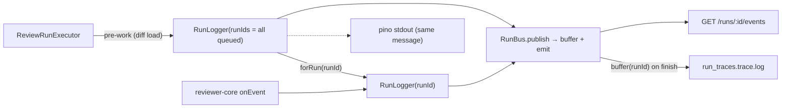

# Run events, trace and lifecycle

How a review run reports progress live, what is saved as its trace, and how runs are listed,
cancelled, deleted and reaped. The run itself is in [review-execution.md](review-execution.md).

## Two stores: memory while running, Postgres after

| What | Where | Lifetime |
|---|---|---|
| live events (`RunEvent`: `seq`, `kind`, `msg`, `t`, `data`) | `RunBus` buffers + EventEmitters, in process memory | this process |
| run row (status, tokens, cost, score, error) | `agent_runs` | permanent |
| full log + prompt + raw output | `run_traces.trace` (one jsonb doc, PK = run id) | permanent, cascades with the run |

`RunEventKind` is `info | tool | result | error`:
`server/src/vendor/shared/contracts/trace.ts:9` (`RunEventKind`).

## Publishing: RunLogger → RunBus

- One `RunLogger` covers all runs of a request, so the shared diff loading shows up in every run's
  Live Log. `forRun` narrows it to one run: `server/src/platform/run-logger.ts:45` (`RunLogger.forRun`).
- `event` publishes to every target run and mirrors the line to pino:
  `server/src/platform/run-logger.ts:50` (`RunLogger.event`).
- `step(label, fn)` emits `label…`, then `label done (Nms)` or an `error` line, and re-throws:
  `server/src/platform/run-logger.ts:75` (`RunLogger.step`).
- `RunBus.publish` assigns a per-run `seq`, stamps wall-clock `HH:MM:SS`, appends to the buffer
  and emits: `server/src/platform/sse.ts:52` (`RunBus.publish`).

## Consuming: the SSE route

`GET /runs/:id/events` is exempt from rate limiting. It bridges the bus to an async generator:
`server/src/modules/reviews/routes.ts:48` (`/runs/:id/events`).

- `subscribe` **replays the buffer first**, then streams live events, so a late subscriber still
  sees the whole run: `server/src/platform/sse.ts:63` (`RunBus.subscribe`).
- Each SSE message has `id = seq`, `event = kind`, `data = JSON(RunEvent)`:
  `server/src/modules/reviews/routes.ts:80` (`yield`).
- The stream ends on `done`. For a run that already completed, `onDone` fires on the next
  microtask so the stream closes right after the replay:
  `server/src/platform/sse.ts:90` (`RunBus.onDone`).

The client-side consumers are described in
[`../../client/docs/pr-page-data-flow.md`](../../client/docs/pr-page-data-flow.md).

## The trace document

On success the executor saves a full `RunTrace`: config (agent, version, provider, model, PR,
`source: 'local'`), stats, `prompt_assembly` from the engine, one `tool_calls` entry per chunk,
`raw_output`, and `log` = the run's whole bus buffer:
`server/src/modules/reviews/run-executor.ts:264` (`trace`). It is upserted by run id:
`server/src/modules/reviews/repository/run.repo.ts:179` (`saveRunTrace`), and read back by
`GET /runs/:id/trace` (404 when missing): `server/src/modules/reviews/routes.ts:121` (`/runs/:id/trace`).

## Failure and cancel

- **Failure** (provider missing, LLM error, schema failure): the run is completed as `failed` with
  `tokensIn: 0, tokensOut: 0, costUsd: null`, the error message, and a minimal trace built from the
  buffer: `server/src/modules/reviews/run-executor.ts:300` (`catch`),
  `server/src/modules/reviews/run-executor.ts:419` (`traceFromBuffer`). Tokens actually spent by a
  failed call are **not** recorded.
- **Cancel**: `POST /runs/:id/cancel` → `ReviewService.cancelRun` publishes an info line, sets the
  cancel flag, marks the row `cancelled` if still `running`, and completes the bus at once. That is
  why it also works for orphaned runs: `server/src/modules/reviews/service.ts:85` (`ReviewService.cancelRun`),
  `server/src/modules/reviews/repository/run.repo.ts:94` (`cancelRunIfRunning`).
- The engine checks `checkCancelled` only **before each chunk's LLM call**:
  `reviewer-core/src/review/run.ts:164` (`checkCancelled`). The executor's callback throws
  `RunCancelledError`, which becomes `status: 'cancelled'`:
  `server/src/modules/reviews/run-executor.ts:217` (`checkCancelled`).

## Run lifecycle routes

| Route | What it does | Code |
|---|---|---|
| `GET /pulls/:id/runs/active` | runs with `status='running'`, joined with agent name | `server/src/modules/reviews/repository/run.repo.ts:10` (`activeRunsForPull`) |
| `GET /pulls/:id/runs` | all runs, any status, newest first | `server/src/modules/reviews/repository/run.repo.ts:40` (`listRunsForPull`) |
| `DELETE /runs/:id` | deletes the run's reviews (findings cascade), then the run (trace cascades) | `server/src/modules/reviews/repository/run.repo.ts:78` (`deleteAgentRun`) |
| `DELETE /reviews/:id` | deletes one review and its findings | `server/src/modules/reviews/routes.ts:135` (`/reviews/:id`) |

## Boot reaper

Before listening, `app.ts` awaits `reapStaleRuns`, which sets every `running` row to `failed`.
It assumes one API instance per database: `server/src/app.ts:82` (`reapStaleRuns`),
`server/src/modules/reviews/repository/run.repo.ts:105` (`reapStaleRunningRuns`).

## Pitfalls

- **Cancel during the LLM call does not stop the run.** In single-pass there is one chunk, so the
  only checkpoint has already passed. `cancelRun` calls `runBus.complete`, which clears the cancel
  flag (`server/src/platform/sse.ts:79`), and `completeAgentRun` has no status guard
  (`server/src/modules/reviews/repository/run.repo.ts:142`). When the call returns, the review is
  saved and the row becomes `done` again.
- `RunBus.complete` deletes the emitter but never the buffer
  (`server/src/platform/sse.ts:76`, `RunBus.complete`): buffers stay in memory until restart.
- Failed and cancelled runs report `0/0` tokens, not null. Treat "both zero" as "no usage"
  (see `client/insights.md`).
